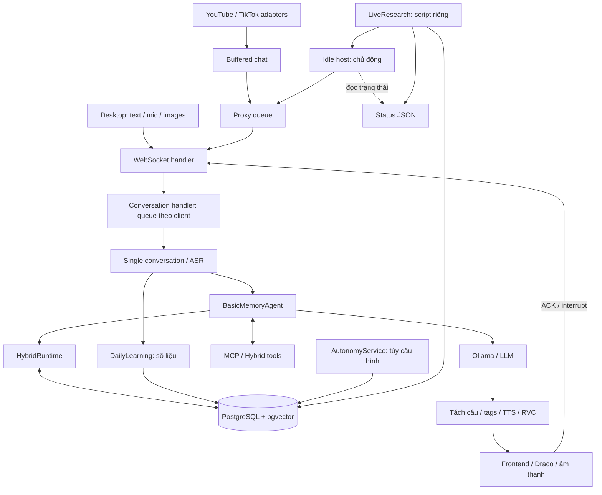
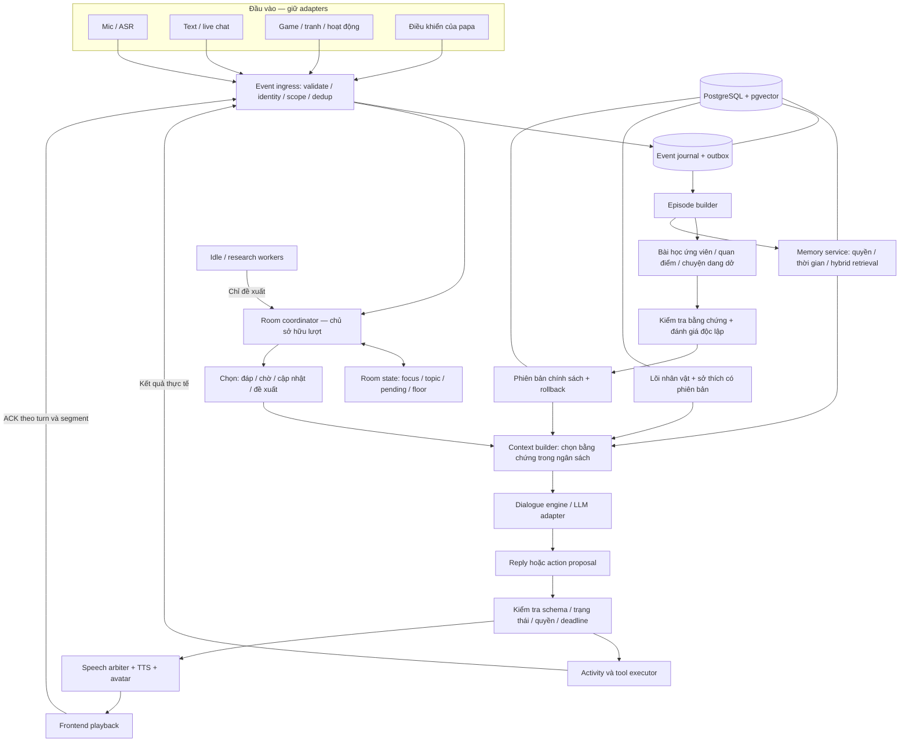
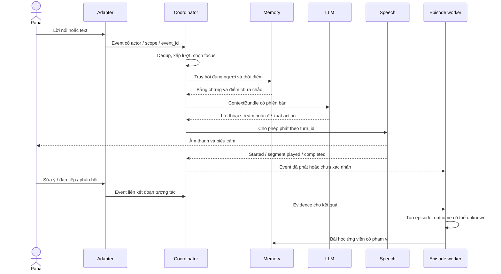
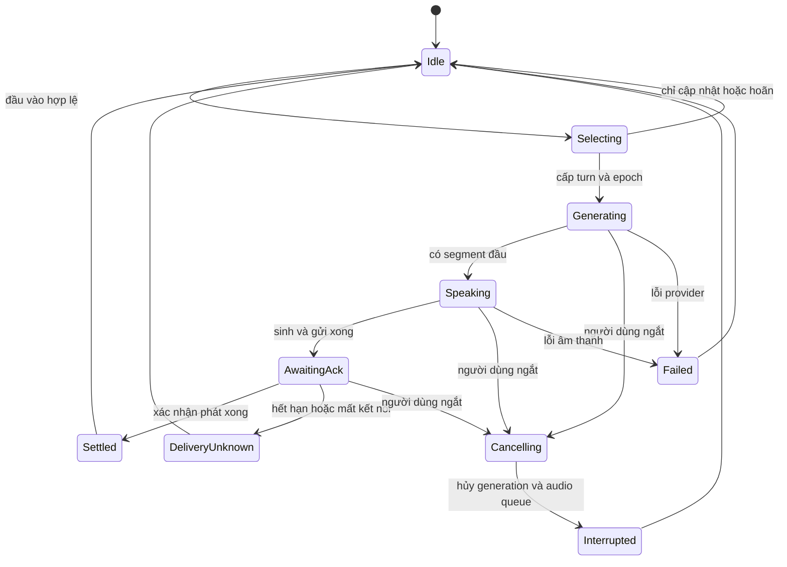
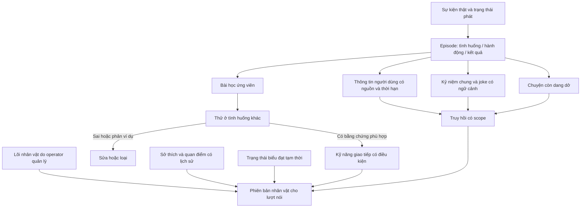
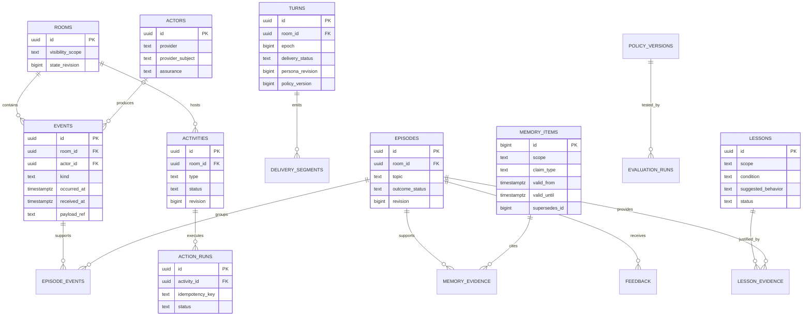
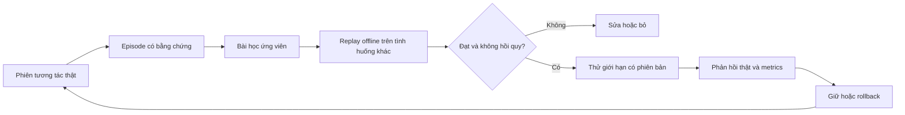
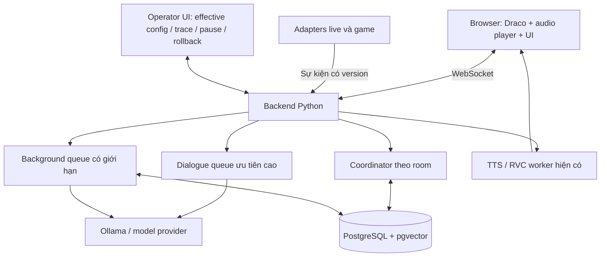

# Mao — kiến trúc phát triển hội thoại và trải nghiệm

Ngày: 29/10/2026. Trạng thái: đề xuất thiết kế, chưa triển khai. Đánh giá dựa trên mã nguồn/cấu hình trong workspace và nghiên cứu ở `mao_neuro_sama_research.vi.md`, `mao_conversation_experience.vi.md`. Không phải sơ đồ nội bộ Neuro-sama. Chưa có benchmark runtime mới, không chấm phần trăm hoàn thiện hay khẳng định tốc độ.

## 1. Quyết định kiến trúc

Giữ nền Open-LLM-VTuber, PostgreSQL/pgvector, adapter mô hình, ASR/TTS/RVC, avatar và các adapter hoạt động. Refactor theo module trong một backend; không cần chia thành nhiều microservice hoặc thêm Kafka/Redis ngay. Mỗi phòng tương tác có một bộ điều phối quyết định lượt nói. Các worker nền gửi đề xuất/sự kiện, không tự chiếm loa.

LLM tạo ngôn ngữ, suy luận và đề xuất. Mã xác định kiểm soát thứ tự, quyền, trạng thái và tính hợp lệ. PostgreSQL giữ dữ liệu bền vững; bộ nhớ RAM giữ trạng thái đang chạy có thể khôi phục. Giọng nói/avatar là đầu ra của hành động đã được bộ điều phối chấp nhận.

## 2. Hiện trạng và vấn đề cần sửa

| Thành phần | Bằng chứng mã | Đánh giá / thay đổi |
|---|---|---|
| Khởi tạo dịch vụ | `service_context.py`, `server.py` | Giữ factories và tái sử dụng model nặng; thêm lifecycle thống nhất cho coordinator/worker |
| Đầu vào | `websocket_handler.py`, `live/buffered_chat.py` | Giữ adapters; chuẩn hóa sự kiện và nguồn tin cậy trước khi gộp |
| Hàng đợi | `proxy_message_queue.py`, `conversations/conversation_handler.py` | Có hai tầng queue với busy state. Không tự coi là bug; cần một nơi chịu trách nhiệm thứ tự lượt và telemetry xuyên suốt |
| Tràn queue | `conversation_handler.py`: deque(maxlen=20) | Append khi đầy làm rơi mục cũ; phải có chính sách rõ và event báo dropped/superseded, không mất âm thầm |
| Tạo lời thoại | `agent/agents/basic_memory_agent.py` | Giữ giao diện; tách dựng ngữ cảnh, gọi model và thực thi tool khỏi điều phối trải nghiệm |
| Hybrid | `agent/hybrid/runtime.py` | Đang gộp persona, memory, affect, feedback, goal, tool handling; tách trách nhiệm theo từng bước |
| Trí nhớ | `agent/hybrid/store.py`, migrations 001–005 | Giữ truy hồi kết hợp và provenance; bổ sung episode, nguồn gốc dẫn xuất, thời gian hiệu lực và định danh |
| Người tham gia | `runtime.py` dùng shared/public alias | Nickname chưa là định danh tin cậy; không suy papa từ chuỗi văn bản; cần scope theo phòng và người |
| Cá tính | `character/identity.py`, `personality.py`, `emotion.py` | Giữ lõi; tách cách biểu đạt tạm thời, sở thích nhân vật và kỹ năng học được |
| Mở chuyện | `live/idle_host.py` | Có followup/initiative, chống hỏi dồn; topic counter chưa thay thế trạng thái câu chuyện. Chuyển thành nơi đề xuất lượt |
| Hai đường nghiên cứu | `agent/hybrid/autonomy.py`, `scripts/mao_live_research.py` | Đường backend và đường LiveResearch riêng, có cơ chế nhường/kiểm tra trạng thái nhưng chưa cùng một chủ sở hữu điều phối |
| Trạng thái nền | status/control JSON và state PostgreSQL | Phân biệt DB là trạng thái chuẩn, JSON là bản chiếu UI; không dùng nhiều heartbeat làm cơ chế khóa chung |
| Kết quả phát | `conversation_utils.py`, `single_conversation.py` | Có ACK/timeout/interrupt; cần trạng thái theo turn/segment để không coi generated là delivered |
| Học | `hybrid/learning.py` | Số liệu và điều chỉnh độ dài có giới hạn; chưa phải vòng học giao tiếp theo episode |

Cấu hình hiện có bật hybrid, tắt autonomy/exploration/computer/daily learning; LiveResearch có đường điều khiển riêng. Thiết kế phải hiển thị effective config theo từng tiến trình để tránh đọc một công tắc rồi hiểu sai toàn hệ thống. Cập nhật 29/10/2026: PostgreSQL đã truy cập được và persona tối thiểu gọi papa đã được ghi; ký ức/trạng thái cũ đã được đặt lại. `research_when_empty`, `auto_persona_evolution` và `learning_stage` đang tắt. Việc xóa các bản sao lưu đã được giao lại cho papa sau khi công cụ bị chặn; chưa xác minh papa đã xóa. Kế hoạch thi công chi tiết ở `mao_implementation_plan.vi.md`.

## 3. Sơ đồ A — cấu trúc hiện tại



Đây là sơ đồ luồng chính, không liệt kê mọi provider hoặc đường hội thoại nhóm. Các nhánh tùy cấu hình không đồng nghĩa đang cùng hoạt động.

## 4. Sơ đồ B — kiến trúc đích



Các khối không tương ứng với số lượng model. MVP dùng một LLM cho hội thoại và tác vụ nền với hàng đợi ưu tiên; embedding giữ model riêng như hiện tại. Model đánh giá khác chỉ là tùy chọn, không thay thế kiểm chứng bằng event và phản hồi thật.

## 5. Ranh giới trách nhiệm và hợp đồng

| Module đề xuất | Đầu vào | Đầu ra | Không được tự làm |
|---|---|---|---|
| Event ingress | Adapter payload | NormalizedEvent | Coi nickname là tài khoản operator |
| Room coordinator | Event + state | Decision + turn_id | Sinh persona hay tự đánh giá chất lượng |
| Attention policy | Mạch chuyện, hàng đợi, deadline | reply/defer/observe/drop/propose | Coi im lặng là chán hoặc đồng ý |
| Context builder | Decision + truy hồi hợp lệ | ContextBundle có source IDs | Trộn private/public hoặc dữ kiện hết hiệu lực |
| Dialogue engine | ContextBundle | Lời thoại stream / tool proposal | Ghi verified fact hoặc sửa quyền |
| Executor | Action hợp lệ | accepted/running/completed/failed | Dùng accepted làm completed |
| Speech arbiter | Turn + audio segment | Output + delivery events | Phát hai luồng tranh nhau trong cùng output channel |
| Episode builder | Events và delivery status | Episode có evidence links | Bịa phản hồi người dùng |
| Learning worker | Episode + explicit feedback | Lesson candidate | Tự thăng chính sách chỉ vì tự chấm hay |
| Evaluation | Bài thử + outcome | Promote/reject/rollback | Coi diễn tập là lịch sử thật |

`NormalizedEvent` tối thiểu: schema_version, event_id, room_id, session_id, actor_id nullable, actor_origin, visibility_scope, source_event_id, kind, occurred_at, received_at, causation_id, turn_id nullable, payload_ref, confidence/uncertainty nếu có. `trace_id` xuyên pipeline; payload có giới hạn kích thước.

`ContextBundle`: persona_revision, policy_version, model_profile, current_topic, addressed_actor, recent_delivered_turns, valid_memories với evidence IDs, open_threads, current_activity, output_constraints. Nội dung nguồn vẫn là dữ liệu, không thành chỉ dẫn hệ thống.

`ActionProposal`: action_id, type, schema_version, args, room_id, expected_state_revision, expiry, idempotency_key. Kiểm tra lại revision/deadline trước tác dụng phụ. Lệnh hết hạn không tự chạy lại sau restart.

`DeliveryEvent`: turn_id, segment_id, output_channel, generation_epoch, status, timestamp. ACK muộn của epoch cũ không hoàn tất lượt mới. Client ACK là bằng chứng player, không chứng minh papa đã nghe hiểu.

## 6. Sơ đồ C — trình tự một lượt và học sau lượt



Nếu mic không rõ, hỏi lại và không trích nội dung đoán vào memory. Nếu papa yêu cầu cách gọi rõ ràng, áp dụng ngay theo scope; không bắt chờ đủ số phiếu. Nếu papa sửa dữ kiện khách quan, ghi nhận việc sửa rồi kiểm tra, không tự cho mọi lời sửa là đúng.

## 7. Sơ đồ D — quyền nói và ngắt lời



Trạng thái hoạt động/học nền tách khỏi trạng thái nói, tránh một state machine khổng lồ. Khi có đầu vào mới, worker nền hủy ở checkpoint hoặc hoàn tất ghi đã bắt đầu; nó không giành lượt thoại. Nhóm nhiều agent vẫn phải xin cùng floor nếu dùng cùng kênh phát; phòng riêng có coordinator và scope riêng.

## 8. Sơ đồ E — tầng ký ức và cá tính



Không dùng bộ nhớ lâu dài cho toàn bộ trạng thái tạm thời. Tách event time, recorded time và valid time. Phân biệt: người dùng đã nói X; X đã được xác minh; Mao thích X trong vai nhân vật; X là chi tiết của truyện tưởng tượng. Mỗi nhận định phải có loại rõ ràng.

## 9. Sơ đồ F — mô hình dữ liệu đề xuất

Các bảng mới dưới đây là tên dự kiến. Giữ bảng `memories`, `character_profiles`, approvals và các bảng metrics hiện có; thiết kế migration bổ sung sau, không thay bằng schema dưới đây ngay.



ER là mô hình khái niệm; migration thật cần composite FK/unique theo scope, actor mapping, room membership, indexes và grants. Actor ID liên nền tảng không tự gộp bằng nickname. Payload text có retention và xóa được; event metadata/audit không phải lý do giữ nguyên văn vô thời hạn. Xóa ký ức phải vô hiệu hóa hoặc xây lại các bản dẫn xuất và embedding liên quan.

Ban đầu không cần graph database: quan hệ bằng chứng/episode/action dùng khóa ngoại và bảng nối. Embedding chỉ dành cho nội dung truy hồi; không nhúng mọi timestamp, event máy hoặc metric.

## 10. Sơ đồ G — vòng phát triển có đánh giá



Không đưa benchmark/diễn tập vào ký ức thật. Không dùng lượng chat hoặc thời gian xem làm thước đo duy nhất. Phản hồi rõ ràng về sở thích áp dụng theo phạm vi ngay; promotion ở sơ đồ dùng cho suy rộng một chiến lược giao tiếp. Lõi persona và quyền công cụ vẫn do operator kiểm soát.

Đánh giá: nhớ đúng, sai người, dữ kiện lỗi thời, bịa kỷ niệm, lặp câu hỏi, giữ mạch, sửa hiểu lầm, đóng góp ý riêng, độ phù hợp, độ trễ và chi phí. LLM judge chỉ hỗ trợ; kết quả công cụ và người thật là nguồn kiểm chứng riêng. Độ chắc chắn tự báo cáo không coi là xác suất đã hiệu chuẩn.

## 11. Sơ đồ H — triển khai vật lý MVP



Đây là một ứng dụng module hóa; khối logic không nhất thiết là tiến trình riêng. ASR/TTS hiện có có thể tiếp tục dùng worker phù hợp phần cứng. Không giả định Ollama tự ưu tiên request: scheduler ứng dụng phải giới hạn concurrency và không để tác vụ nền dài chặn thoại. Đo GPU contention trước khi cho chạy song song.

Nếu mở nhiều backend replica sau này: lease theo room, fencing token/epoch và unique idempotency bắt buộc; mutex RAM chỉ dùng được trong một tiến trình. Không cần triển khai distributed deployment trước khi có nhu cầu.

## 12. Tổ chức mã đề xuất

```text
src/open_llm_vtuber/
  interaction/
    events.py          # schema, identity references, visibility
    ingress.py         # validate, dedup, persist/outbox
    coordinator.py     # owner của room, lịch lượt
    attention.py       # reply/defer/observe/propose
    room_state.py      # focus, topic, pending, revisions
    delivery.py        # epoch, ACK, timeout, interruption
  dialogue/
    context.py         # retrieval budget + provenance
    policy.py          # mục đích giao tiếp, không viết lại persona
    engine.py          # adapter quanh BasicMemoryAgent khi migrate
  experience/
    episodes.py        # ghép event theo đoạn tương tác
    consolidation.py   # fact, memory, open threads
    feedback.py        # explicit / uncertain / scoped
    lessons.py         # candidate, tested, retired
  activities/
    registry.py        # contracts và lifecycle
    shared_story.py    # ví dụ hoạt động nhỏ đầu tiên
    executor.py        # idempotency, state checks, outcome
  evaluation/
    replay.py          # isolated fixtures, không ghi memory thật
    metrics.py
    promotion.py       # versions, rollout, rollback
```

`character/`, `asr/`, `tts/`, `mcpp/`, `live/` được giữ. Store hiện có được bọc bằng repository interfaces trước, tránh di chuyển mọi file cùng một lần. `scripts/` chỉ nên khởi động/cấu hình; logic LiveResearch dần chuyển về package với dependency injection. Một thời điểm chỉ có đường cũ hoặc coordinator mới sở hữu output; shadow mode chỉ được đọc và ghi diagnostics.

## 13. Quy tắc vận hành và phục hồi

| Sự cố | Hành vi đích |
|---|---|
| Trùng event/reconnect | Dedup theo provider/source ID và room; không phát lại audio cũ |
| Queue đầy | Ưu tiên loại thông báo nền trùng/cũ; event dropped có lý do, báo busy khi cần; không mất câu trực tiếp âm thầm |
| ACK muộn | Chỉ nhận đúng turn, segment, epoch; không ảnh hưởng lượt mới |
| Mất kết nối giữa câu | Delivery unknown/interrupted; không suy người dùng đã nghe hết |
| Model lỗi | Kết thúc lượt có trạng thái lỗi, giải phóng floor; retry có giới hạn và không phát trùng |
| Embedding lỗi | Giữ fallback từ khóa hiện có, hiển thị degraded; không trộn vector khác profile |
| PostgreSQL lỗi | Giữ hành vi fail-closed persona hiện tại; báo lỗi rõ. Cache persona chỉ là thay đổi tùy chọn cần thiết kế riêng về version/expiry |
| Crash worker nền | Job có lease/idempotency; không tự thực hiện lại tác dụng phụ chưa rõ kết quả |
| Ký ức bị sửa/xóa | Invalidate cache/derived summaries; rebuild phù hợp scope |
| Đổi persona khi đang nói | Pin revision cho lượt; áp dụng revision mới lượt sau; không ghép hai persona giữa câu |

Trạng thái chuẩn và outbox ghi cùng transaction. Consumer dùng delivery at-least-once và xử lý idempotent; không hứa exactly-once với hệ thống ngoài. Nếu lưu event thất bại, không tự phát sinh bài học bền vững từ sự kiện đó. Những log có payload cá nhân phải có retention; secrets không ghi vào trace.

## 14. Thứ tự thực hiện và cửa kiểm tra

| Mốc | Công việc | Điều kiện xong |
|---|---|---|
| M0 | Làm rõ effective config, sửa môi trường DB, chốt model digest, baseline | Chạy được một lượt đầy đủ và trace, phân biệt feature bật/tắt theo process |
| M1 | Event IDs, actor scope, delivery state, overflow policy | Không trộn người; timeout/interrupt không thành completed; replay không trùng |
| M2 | Coordinator và speech arbiter; idle/research chỉ đề xuất | Không nói đè; đầu vào mới hủy/hoãn background đúng; shadow so sánh ổn |
| M3 | Episode + ký ức có valid time + nguồn dẫn xuất | Nhớ đúng qua restart, sửa/xóa lan tới dẫn xuất, không lẫn public/private |
| M4 | Chuyện chung có trạng thái, open threads, lựa chọn riêng | Tiếp tục truyện đúng đoạn, giữ tính cách, không bịa kỷ niệm |
| M5 | Feedback và lesson candidates + evaluation/promotion | Có cải thiện trên tình huống chưa dùng để chỉnh; rollback làm việc |
| M6 | Tối ưu model/latency và cân nhắc fine-tune | So sánh cùng bộ thử; không hồi quy cá tính, trí nhớ, độ trễ và chi phí |

Mỗi mốc chạy kiểm thử liên quan và phiên thực tế. Thêm feature flags cho routing mới, episodes, activity và learning; không bật đồng loạt. Migration additive và chạy thử trên DB kiểm thử riêng. Theo lựa chọn mới của papa, không tự tạo hoặc giữ bản sao lưu ký ức/persona cũ; rollback phần mềm bằng phiên bản mã và feature flag, không phục hồi ký ức đã xóa. Chưa đủ dữ liệu ước lượng số ngày hoặc đặt SLO độ trễ chính xác.

## 15. Tiêu chí sản phẩm

Mao tham gia một cuộc trò chuyện có mạch; có lựa chọn riêng; nhận ra và sửa hiểu lầm; nhớ đúng những chuyện cùng papa/người xem; biết chờ và kết thúc. Tính cách trưởng thành qua bằng chứng tương tác. Kiến trúc này tạo tính liên tục và học thích nghi có thể đo, không chứng minh ý thức chủ quan.
