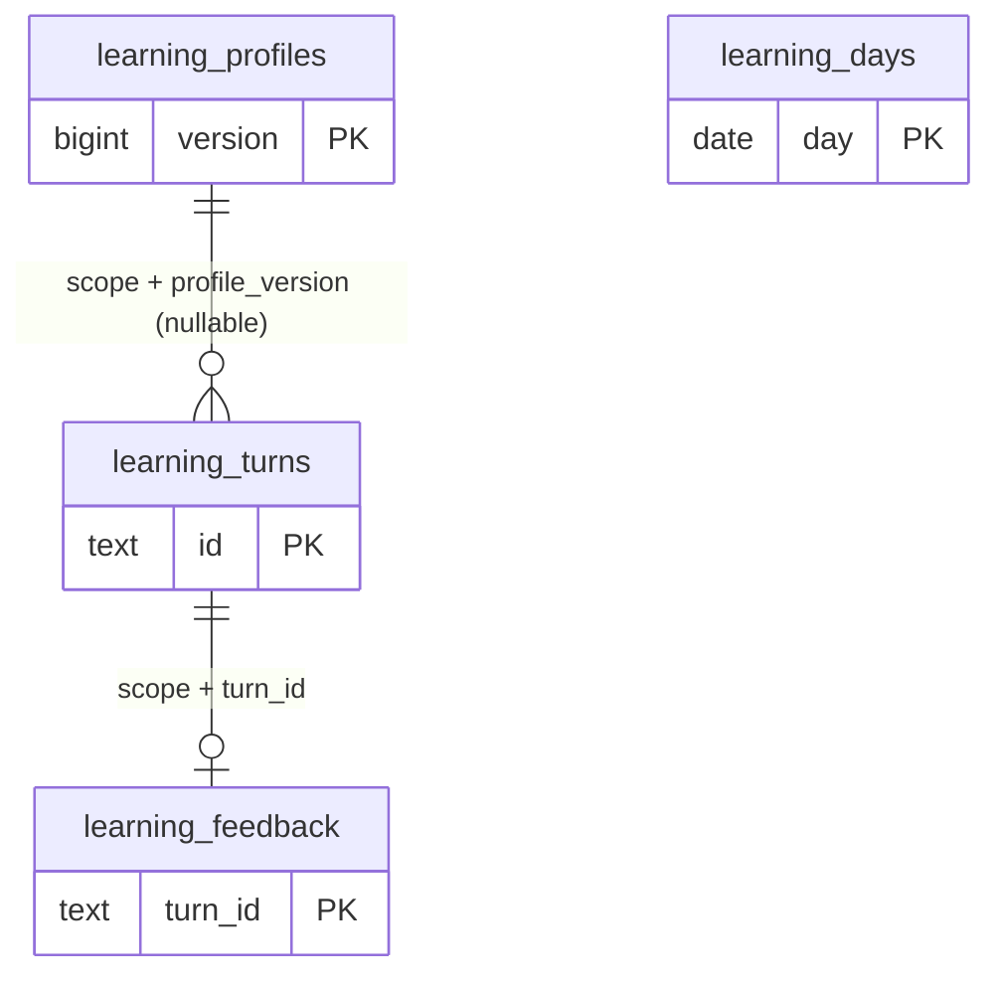

# Mao: học có bằng chứng và diễn tập livestream

## Phạm vi đang triển khai

Giữ Qwen `mao-companion`, VieNeu → RVC Linh Lan và avatar 3D hiện tại. Bộ nhớ chính dùng PostgreSQL + pgvector, không thêm SQLite. Chức năng học mới đo từng lượt và tổng kết ngày; không tự sửa mã nguồn, quyền máy tính, persona cốt lõi hay trọng số Qwen. Công cụ trình duyệt có chốt quyền riêng; quyền toàn bộ Windows chưa được triển khai.

Nghiên cứu [Generative Agents](https://arxiv.org/abs/2304.03442) gợi ý tách quan sát, bộ nhớ, suy ngẫm và kế hoạch. [Reflexion](https://arxiv.org/abs/2303.11366) nghiên cứu dùng phản hồi và ký ức để cải thiện lần thử sau mà không cập nhật trọng số. Đây là cơ sở thiết kế, không phải bằng chứng Mao sẽ đạt kết quả tương tự. Nghiên cứu về [giới hạn tự sửa lỗi](https://arxiv.org/abs/2310.01798) là lý do không cho lời tự chấm của Qwen làm bằng chứng chất lượng.

## Vòng lặp hằng ngày

1. Ghi số từ, thời gian đến gói âm thanh đầu tiên, tổng thời gian lượt, số gói âm thanh, lỗi và gián đoạn. Không sao chép nội dung hội thoại vào bảng học: chỉ lưu dấu băm câu trả lời để đếm lặp. Nhật ký hội thoại cũ của ứng dụng vẫn có cơ chế lưu riêng.
2. Người vận hành đánh giá một số lượt bằng nhãn cố định. Quyền ứng dụng chỉ được đọc bảng đánh giá; chatbot và khán giả không có công cụ gửi điểm này.
3. Khi backend chạy, một tác vụ kiểm tra mỗi 5 phút và tổng kết các ngày đã kết thúc theo `Asia/Ho_Chi_Minh`. Sau khi bật máy lại, xử lý bù trong cửa sổ lưu giữ. Không cần để Codex mở. Khi máy/backend tắt, tác vụ không chạy.
4. Mỗi ngày/phạm vi chỉ có một báo cáo. Khóa và giao dịch PostgreSQL ngăn hai phiên áp dụng trùng. Báo cáo đã hoàn tất không tự bị viết lại khi có phản hồi muộn; phản hồi muộn được xét vào ngày gửi phản hồi.
5. Mặc định cần 20 lượt thật/ngày. Chỉ xét phản hồi về các lượt mở chuyện thuộc phiên bản đang dùng. Ít nhất 3 nhãn `too_long` và không có `too_short` thì giảm giới hạn 5 từ; ngược lại tăng 5 từ. Luôn giữ trong 40–60 từ. Nhãn `incorrect`/`unsafe` chặn điều chỉnh theo độ dài và đưa giới hạn về mặc định khi ngày đủ dữ liệu. Đây chỉ là điều chỉnh sở thích độ dài, không phải biện pháp tự sửa kiến thức hay an toàn.
6. Bản diễn tập được gắn loại `rehearsal`, không được tính để đủ lượt hay tạo phản hồi áp dụng. Thiếu dữ liệu hoặc phản hồi mâu thuẫn: giữ nguyên. Mỗi thay đổi có phiên bản và lý do; có lệnh đặt lại mặc định.

Hệ thống chưa tự xác minh chất lượng kiến thức, không dùng thời gian xem hoặc số tin nhắn để suy ra mức hài lòng, không dùng một lần tự đánh giá làm tiêu chí nâng cấp. Báo cáo luôn có `quality_improvement_verified: false`. Chỉ có thể kết luận tiến bộ sau đánh giá độc lập trên nhiều ngày/bài thử chưa dùng để hiệu chỉnh. Bộ đánh giá truy hồi hiện có trong `scripts/evaluate_mao_retrieval.py` là kiểm tra riêng, không được giả danh kết quả livestream.

## Thiết lập và sử dụng

Từ thư mục dự án, sau khi dựng PostgreSQL theo tài liệu hybrid:

```powershell
.\.venv\Scripts\python.exe scripts/mao_hybrid.py migrate
.\.venv\Scripts\python.exe scripts/mao_learning.py status
```

Trong `conf.yaml` và `characters/mao_live.yaml`, dưới `basic_memory_agent.hybrid`:

```yaml
learning_enabled: true
learning_timezone: Asia/Ho_Chi_Minh
learning_min_turns: 20
learning_min_feedback: 3
learning_retention_days: 90
```

Khởi động lại backend sau thay đổi cấu hình. `status` hiển thị 20 mã lượt gần nhất và 7 báo cáo ngày. Mã lượt cũng xuất hiện trong log sau khi hoàn tất. Để phản hồi một lượt đã quan sát:

```powershell
.\.venv\Scripts\python.exe scripts/mao_learning.py feedback --turn MA_LUOT --label too_long
.\.venv\Scripts\python.exe scripts/mao_learning.py review --day 2026-10-24
.\.venv\Scripts\python.exe scripts/mao_learning.py reset
```

Nhãn khác: `useful`, `too_short`, `incorrect`, `unsafe`. Chỉ người vận hành có tệp quyền riêng mới chạy được lệnh ghi đánh giá/reset. Không đăng thông tin đăng nhập hoặc tệp `private/mao-hybrid.env`. Cập nhật điểm của một lượt thay thế điểm cũ, không tạo thêm phiếu. Lệnh reset tạo phiên bản mới với giới hạn 60 từ, không xóa lịch sử.

Để dạy kiến thức/kỹ năng đã kiểm tra, tạo tệp JSON riêng gồm đúng ba trường `kind` (`skill` hoặc `long_term`), `content` (bài học) và `evidence` (nguồn hoặc kết quả kiểm tra), mỗi trường văn bản tối đa 1.000 ký tự. Chạy `python scripts/mao_learning.py teach --lesson-file DUONG_DAN_JSON` bằng Python của dự án. Bài học được nhúng vào pgvector, lưu provenance `operator` và truy hồi cho lần sau; không thực thi nội dung như mã hay quy tắc hệ thống. Provenance chỉ xác nhận ai cung cấp, không tự chứng minh nội dung đúng. Không đưa bí mật vào bài học.

## DB bổ sung



Các khóa chính còn có `scope` theo migration 004; `learning_profiles` có khóa duy nhất `(scope,version)` làm đích FK. `learning_days` giữ số liệu tổng hợp và phiên bản áp dụng. Không thêm vector cho số liệu đo đạc; pgvector tiếp tục dùng cho ký ức ngữ nghĩa. Xóa lượt hết hạn kéo theo điểm đánh giá bằng FK cascade; báo cáo ngày lưu tối đa cửa sổ cấu hình. Lịch sử phiên bản nhỏ được giữ để kiểm tra/quay lui.

## Livestream: chỉ diễn tập trên máy

[OBS khuyến nghị ghi thử trước khi phát](https://obsproject.com/kb/quick-start-guide). Bản thử này dùng OBS portable 33.0.0, cảnh riêng 1280×720, 30 fps, một Browser Source. Trang thử kết nối WebSocket thật tới backend và chạy bốn lượt: chào, đùa phép tính, sửa nghiêm túc, nói về học tập. Tiếng là TTS/RVC thật, không lồng tệp ghi sẵn. Có nhãn **THỬ TRÊN MÁY · CHƯA PHÁT CÔNG KHAI**; không tạo bình luận hoặc số khán giả giả.

Nguồn chỉ có Mao, không lấy toàn màn hình, mic hay âm thanh toàn máy. Âm thanh trình duyệt được đưa riêng vào OBS và không monitor ra thiết bị, tránh phát hai lần. Mọi điều khiển dùng [obs-websocket có xác thực](https://github.com/obsproject/obs-websocket/blob/master/docs/generated/protocol.md); mật khẩu nằm trong `private/`, không truyền trên dòng lệnh. OBS có thể lắng nghe trên các card mạng khi bật điều khiển; launcher chỉ bật trong lần thử và đóng OBS sau đó. Không mở cổng trên router. Không có khóa phát và không gọi StartStream.

Chạy lại:

```powershell
.\.venv\Scripts\python.exe scripts/setup_mao_obs.py
.\scripts\start_mao_rehearsal.ps1 -Seconds 120
```

Đóng các OBS đang dùng trước khi chạy launcher, vì nó dành cho phiên thử riêng. Launcher khởi động backend, OBS ẩn, cấu hình cảnh, ghi MKV và đóng phiên OBS nó tạo. Ghi hình ở `private/rehearsals/`; số liệu OBS ở `logs/mao-obs-rehearsal.json`. MKV tránh hỏng toàn bộ bản ghi khi bị dừng đột ngột; có thể chuyển sang MP4 sau khi ghi xong.

Trên máy mới, `setup_mao_obs.py` tải ZIP Windows x64 từ [release OBS chính thức](https://github.com/obsproject/obs-studio/releases/tag/33.0.0), kiểm tra SHA-256 `3369a3ecd67b5669a8a08d77357f87cc786d1fba42fbbd1054d841a69f6271a7`, giải nén vào `private/tools/obs-33.0.0` và tạo cấu hình ghi MKV/mật khẩu riêng nếu chưa tồn tại. Nó giữ cấu hình có sẵn. Không chép mật khẩu từ ví dụ công khai.

Chuẩn bị để phát thật sau này vẫn cần người vận hành thiết lập tài khoản/kênh, khóa phát trong OBS, kiểm tra âm lượng/độ trễ và duyệt cảnh sẽ phát. YouTube chat reader hiện trỏ tới `@sejuly-02`, không có livestream đang hoạt động khi kiểm tra. Reader chỉ đọc chat; nó không tự tạo hoặc bắt đầu buổi phát. Chưa kiểm thử đường truyền lên YouTube trong lượt diễn tập này.

## Kiểm thử

```powershell
$env:MAO_TEST_POSTGRES='1'; $env:MAO_TEST_BROWSER='1'
.\.venv\Scripts\python.exe -m unittest discover -s tests -p 'test_*.py' -q
node --test tests/*.mjs
```

Kiểm thử mới bao gồm quyền ghi điểm, FK chống trộn phạm vi, không lưu văn bản thô trong bảng học, dữ liệu diễn tập không làm thay đổi chính sách, ngưỡng phản hồi, mâu thuẫn, giới hạn từ, câu hoàn chỉnh và tổng kết không lặp. Báo cáo diễn tập thực tế phải kèm số khung hình bỏ lỡ và kiểm tra track âm thanh; sự tồn tại của tệp video riêng lẻ chưa đủ kết luận mọi thứ hoạt động tốt.
