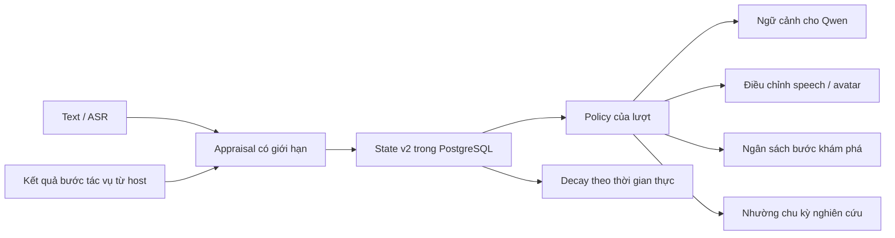

# Hệ cảm xúc chức năng Mao — triển khai v2

Ngày kiểm tra và triển khai: 29/10/2026, Asia/Saigon. Căn cứ: [đoạn chat được cung cấp](https://chatgpt.com/share/6ae316c2-e26c-83ec-aa4e-da4b46e73cf4), mã nguồn Mao hiện tại và các nguồn gốc bên dưới. Đây là phần lõi cảm xúc được triển khai theo yêu cầu mới, chưa phải hoàn tất toàn bộ M5 hoặc vòng tự phát triển tính cách.

## Kết quả nghiên cứu và lựa chọn

- **FAtiMA:** tài liệu gốc tách Emotional Appraisal khỏi Emotional Decision Making; Role Play Character nối chúng thành chu kỳ nhận biết–hành động. Toolkit dùng C#. Mao áp dụng cách tách trách nhiệm đó bằng Python, không cài hoặc tuyên bố đang chạy thư viện FAtiMA. [ReadMe chính thức](https://github.com/GAIPS/FAtiMA-Toolkit/blob/master/ReadMe.md).
- **Emotion System v2:** repository mô tả appraisal, trạng thái đa chiều, nhiều kênh cảm xúc, decay và điều chỉnh chính sách. Đây là nguồn thiết kế; các hệ số trong Mao là lựa chọn kỹ thuật ban đầu cần hiệu chỉnh, không phải kết quả thực nghiệm của dự án nguồn. [Đặc tả](https://github.com/swaylq/emotion-system/blob/main/SKILL.md), [appraisal](https://github.com/swaylq/emotion-system/blob/main/references/appraisal-engine.md).
- **Soul Protocol:** nhận định trong chat rằng nhiều chức năng còn thiếu đã lỗi thời ở một số điểm. Gap analysis được cập nhật 25/05/2026 đã liệt kê multi-user, dream cycle và công cụ optimize; bản dev và bản phát hành có khác biệt. Tài liệu cũng mô tả `purge` kèm `.soul.bak`. Vì Mao đã có PostgreSQL, persona có thẩm quyền và yêu cầu không tạo backup ký ức, đợt này giữ hạ tầng sẵn có. Không thêm một bộ nhớ hay định dạng export thứ hai. [Gap analysis chính thức](https://github.com/qbtrix/soul-protocol/blob/main/docs/GAP-ANALYSIS.md).

Không dùng điểm benchmark do tác giả tự công bố để kết luận engine nào tốt nhất hoặc có cảm xúc chủ quan. Bản triển khai này dùng trạng thái chức năng có thể kiểm tra, không khẳng định trải nghiệm chủ quan.

## Luồng đang chạy



`character/appraisal.py` nhận sự kiện và tạo đối tượng chỉ có enum cùng số hữu hạn: mức liên quan, thuận/nghịch mục tiêu, khả năng tác động, độ chắc, mới lạ, khẩn cấp và độ tin cậy của phân loại. Bộ phân tích text dùng quy tắc Việt/Anh có lọc phủ định, lời trích, code và một số ngữ cảnh kể lại. Nó không đọc tâm trí, không dùng camera hoặc cảm xúc giọng nói, chưa xử lý đầy đủ mỉa mai/ngữ dụng. Không có lượt gọi LLM bổ sung cho appraisal.

Từ 30/10/2026, `character/contextual_appraisal.py` bổ sung ngữ cảnh ngắn. Chỉ exchange gần nhất của cùng actor/phòng/visibility, đã phát hoàn tất và được host ghi nhận trong 10 phút, mới được dùng để hiểu câu nối tiếp như “vẫn vậy”. Câu có/câu không chỉ được nối với câu hỏi một lựa chọn rõ ràng; câu hỏi nhiều lựa chọn hoặc có phủ định phức tạp được bỏ qua. Lời của assistant không tự trở thành tâm trạng người dùng. Yêu cầu hiện tại, đổi chủ đề và thông báo đã ổn được ưu tiên. Một số câu khen kèm kết quả xấu rõ ràng được xử lý thận trọng như dấu hiệu mỉa mai; đây vẫn là quy tắc có giới hạn, chưa phải hiểu ngữ cảnh ngữ nghĩa tổng quát.

`character/emotion.py` giữ năm chiều pleasure/arousal/agency/certainty/novelty và bảy kênh joy/curiosity/concern/frustration/gratitude/uncertainty/confidence. Nhiều kênh có thể cùng hoạt động. Mỗi sự kiện tạo một thay đổi nhỏ, có bão hòa; các kênh không bị thay bằng một nhãn duy nhất. State tương thích các trường mode/valence/arousal cũ.

Decay dùng thời gian đã trôi qua, không dùng số lần đọc state. Arousal/novelty giảm nhanh hơn frustration. Sau 30 phút không có sự kiện mới, affect tức thời trở về baseline. Đây là thông số kỹ thuật ban đầu. Im lặng không tạo sự kiện bị bỏ rơi, cô đơn, đói, buồn ngủ hoặc áp lực buộc người dùng quay lại.

## Những hành vi đã thay đổi thực tế

| Tình huống | Hành vi của controller |
|---|---|
| “Đừng đùa”, “chỉ muốn kể thôi” | Chọn support, hướng dẫn nghe trước; đầu ra TTS loại native cue, dùng cách đọc nhẹ và điều chỉnh biểu cảm về neutral |
| Người dùng báo câu trả lời sai | Chọn repair và yêu cầu kiểm tra lại; không coi lời sửa là sự thật đã xác minh |
| Host báo ASR không rõ | Chọn clarify cho lượt hiện tại; không lưu đó thành tâm trạng hay sở thích người nói |
| Người dùng nói đã ổn và muốn đùa | Yêu cầu mới thay thế hạn chế của lượt trước; trạng thái nền không bị xóa ngay |
| Ba lần thất bại tác vụ gần nhau | Frustration vượt ngưỡng điều chỉnh; mỗi lần explore tiếp theo chạy tối đa một bước trước khi cần xem lại kế hoạch |
| Thành công tác vụ đã được host kiểm tra | Giảm frustration, tăng confidence và cập nhật bộ đếm kết quả |
| Đang trong cửa sổ ưu tiên hội thoại | Worker nghiên cứu nhường ở đầu chu kỳ, trước tìm nguồn và nói |

Thay đổi số bước khám phá được áp dụng trong `HybridRuntime.explore`, không chỉ viết vào prompt. Nếu còn bước chưa chạy, goal có trạng thái `needs_revision` và `pause_reason=affect_reassessment`; không ghi skill thành công cho kế hoạch chưa hoàn tất. Cảm xúc không bật exploration/computer, không tăng quyền truy cập, không bỏ cooldown, lease hoặc kiểm tra bằng chứng hiện có.

Kết quả task được lấy từ đánh giá bước explore thực tế. Câu chat “tôi thắng rồi” chỉ là lời người dùng, không tăng bộ đếm thành công của Mao. `competence.efficacy` là ước lượng có prior từ các kết quả cơ học, không phải phép đo năng lực tổng quát. Đợt này chưa nối toàn bộ game event/provider result vào engine.

`character/expression.py` áp dụng policy vào `SpeechProsody` và `Actions` trước TTS. Giữ cách đọc solemn/proud của câu có nội dung phù hợp. Ngoài các trường hợp cần điều tiết, tôn trọng nhãn cảm xúc của câu và `[neutral]`. Snapshot được giữ trong suốt lượt để yêu cầu không đùa không hết hạn giữa một câu trả lời dài. Không bổ sung API cảm xúc giả cho VieNeu; tiếp tục dùng tempo/pause và native cues vốn có.

## State, riêng tư và giới hạn

State vẫn nằm ở `mao_hybrid.state`, không cần migration SQL mới hoặc sao lưu. Key `affect` dành cho host/worker chung; đường interaction mới dùng key `affect:context:<sha256(room,actor,visibility)>`. Cuộc trò chuyện mới không kế thừa mood chung/cũ, và private/public/test không trộn lẫn. JSON state vẫn là schema v2. Các lần cập nhật được tuần tự hóa bằng advisory lock; scoped writer lấy cùng room lock với thao tác quên. Dedup affect là cửa sổ 32 event ID gần nhất; đường interaction truyền event ID đã được journal chấp nhận, thay vì tạo ID khác khi prepare lại.

Không lưu transcript, tên người dùng, hồ sơ quan hệ hoặc chỉ số “tình yêu” trong state này. State hội thoại riêng là trạng thái điều phối, không phải mức gắn bó với người đó. Nickname không xác thực actor. Input riêng chỉ cập nhật tín hiệu chú ý trung tính cho host chung để worker nhường 90 giây; không sao chép cue, kênh cảm xúc hay bộ đếm tác vụ riêng sang host.

Scoped input được kiểm tra lại nguồn trong transaction: phải đúng actor/phòng/visibility, không synthetic, chưa bị quên hoặc redact raw. Nguồn ngữ cảnh nối tiếp cũng được kiểm tra lại. Quên nguồn xóa bảo thủ state của đúng actor/phòng/visibility và chặn ghi lại muộn từ nguồn đó. State hội thoại không hoạt động 30 ngày được dọn khi có lần ghi affect tiếp theo. Clipboard, game narration, rehearsal và proactive prompt không tự tạo sự kiện cảm xúc người dùng. Lỗi affect trở về neutral trong lượt hiện tại; ký ức truy hồi thành công vẫn được giữ.

Reset có đủ room/actor/visibility chỉ xóa state được chọn. Reset không chọn hội thoại xóa toàn bộ affect trong scope, giữ các key state khác và không tạo backup.

Nền episode/evidence, coordinator và candidate giao tiếp M1–M7 đã được triển khai, xem `mao_runtime.vi.md`. Affect không tự cập nhật OCEAN, học loại cảm xúc mới hoặc huấn luyện Qwen. Chỉ dẫn support/repair cho nội dung Qwen là hướng dẫn sinh văn bản; controller kiểm soát chắc hơn ở ngân sách tác vụ và metadata giọng/avatar, không bảo đảm mọi câu trả lời tự do đều phù hợp.

## Cách dùng và kiểm tra

Mặc định `hybrid.emotion_enabled: true`. Đặt `false` trong cấu hình hybrid rồi restart backend để tắt appraisal/state/output regulation cho hội thoại; worker dùng Store cũng không cập nhật affect. Không đổi các flag autonomy/exploration/learning khác. Restart các worker đang chạy để chúng dùng cùng phiên bản code.

Chỉ đọc state hiện tại:

```powershell
.venv/Scripts/python.exe scripts/mao_emotion.py status
```

Lệnh trên đọc host chung. Đọc state hội thoại bằng ID do host xác thực:

```powershell
.venv/Scripts/python.exe scripts/mao_emotion.py status --room ROOM_ID --actor ACTOR_ID --visibility private
```

Kiểm thử cập nhật 30/10/2026: 17 bài mới cho context và cách ly affect; full suite 460 bài, 450 đạt và 10 bỏ qua theo điều kiện. Báo cáo `logs/mao-contextual-full-tests.log`. Kiểm thử này không chứng minh độ tự nhiên của cảm xúc trong phiên người dùng thật.

Smoke qua WebSocket/LLM/TTS thực đã đạt ba lượt: người A yêu cầu lắng nghe, A nói tiếp “vẫn vậy”, người B chào mà không nhận concern của A. Playback được giả lập và không phải bằng chứng người thật đã nghe. Báo cáo `logs/mao-contextual-smoke.json`. Có thể chạy lại trên server profile test bằng `scripts/mao_affect_smoke.py`; script từ chối endpoint không phải profile/scope test trước khi gửi fixture.

Sau sửa speech recovery cho hybrid/native tool, smoke với `--closure-rounds 6` đạt 9 lượt, tất cả có trạng thái delivery completed; bao gồm lặp các câu kết thúc/tạm hoãn hội thoại từng gây đầu ra rỗng. Chín lượt này không kích hoạt retry; tình huống đầu ra chỉ có tag/emoji được kiểm tra bằng fault injection trong native-tool pipeline, xác nhận lượt phục hồi không truyền tool schema và không gọi executor. Nghiệm thu soak 2 giờ vẫn cần chạy lại từ đầu trên bản sửa mới.

Replay giả lập, không đụng database:

```powershell
.venv/Scripts/python.exe scripts/mao_emotion.py replay --output logs/mao-emotion-replay.json
.venv/Scripts/python.exe scripts/mao_emotion.py replay --stateless --output logs/mao-emotion-ablation.json
```

Lệnh stateless cố ý trả exit 1 ở tình huống cần tích lũy thất bại: đó là ablation, không phải lỗi của bản stateful. Corpus có version tại `tests/fixtures/mao_emotion_v2.json`.

Test với PostgreSQL riêng của M0:

```powershell
docker compose -f compose.mao-test.yaml up -d --wait
.venv/Scripts/python.exe scripts/mao_test.py --postgres
.venv/Scripts/python.exe scripts/mao_emotion.py status --test-database
```

Smoke test model và voice thật, cần model/tài nguyên local hiện có và môi trường ffmpeg/HF_HOME như runbook M0:

```powershell
.venv/Scripts/python.exe scripts/check_mao_emotion.py
```

Smoke dùng scope giả lập riêng trong DB test, không ghi history, dọn dữ liệu scope đó sau khi chạy. Báo cáo chỉ có state, policy, metadata speech, số audio chunk và loại lỗi. ACK trong test được giả lập; không nghiệm thu microphone, loa hoặc việc avatar thật đã hiển thị. CLI `reset` chỉ dành cho operator khi chủ động muốn xóa affect; đợt triển khai này không chạy reset trên Mao thật.

## Kết quả kiểm chứng

- Toàn bộ suite cuối đã chạy với PostgreSQL test: **405 bài, 395 đạt, 10 skipped**, không failure/error; gồm 26 bài mới cho appraisal/state/output/controller/DB.
- Replay stateful đạt 5/5 chuỗi tình huống. Stateless mất thay đổi ngân sách sau nhiều lần thất bại, đúng mục tiêu ablation. Đây là kiểm thử controller, không phải đánh giá hội thoại người thật.
- Smoke Qwen `mao-companion` + VieNeu/RVC thật đạt cả hai lượt: support tạo audio với `gentle`, tempo 0.96, không native cue; lượt vui tiếp theo tạo audio với `bright`, tempo 1.06. Cả hai có phản hồi và audio, không lỗi. Scope kiểm thử đã được dọn.
- Test DB bao gồm restart kết nối, cách ly scope, reset không ảnh hưởng key khác và worker đồng thời ghi cùng event ID.

Báo cáo máy local trong `logs/mao-emotion-all-tests-final.log`, `logs/mao-emotion-v2-final-tests.log`, `logs/mao-emotion-replay.json`, `logs/mao-emotion-ablation.json`, `logs/mao-emotion-smoke.json` (đều bị Git ignore).
