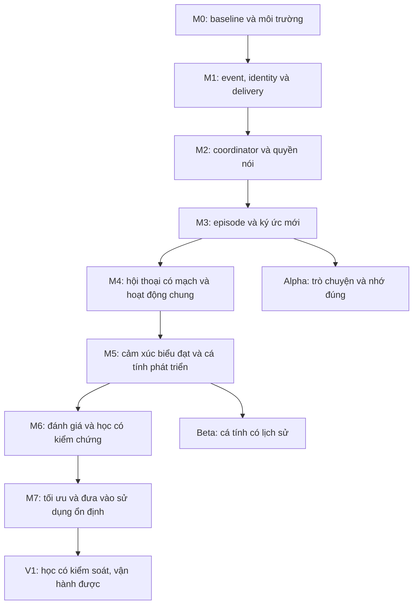

# Mao — kế hoạch triển khai kiến trúc và phát triển cá tính

Ngày 29/10/2026, Asia/Saigon. Trạng thái: đã triển khai các module và tích hợp M1–M7, migration 006–009, dashboard và công cụ vận hành. Hướng dẫn cùng giới hạn bản đầu ở [mao_runtime.vi.md](mao_runtime.vi.md). Các gate phiên thật, soak và SLO dưới đây vẫn phải đối chiếu với báo cáo thực tế; không suy ra chúng đã đạt chỉ vì đã có code.

Cập nhật M0 ngày 29/10/2026: đã thêm doctor, profile runtime, launcher local, test runner/DB riêng và baseline pipeline giả lập. Hướng dẫn: `mao_runtime_runbook.vi.md`. Tại mốc M0 đã chạy 379 bài test với PostgreSQL riêng: 369 đạt, 10 skipped, không failure/error; baseline có 2 mẫu text, 2 mẫu voice và một lượt cancellation. Playback là sink mô phỏng, chưa nghiệm thu thiết bị/frontend thật. Báo cáo: `logs/mao-baseline.json`, `logs/mao-doctor-test.json`, `logs/mao-m0-tests-final.log` (Git ignore).

Cập nhật cảm xúc theo yêu cầu tiếp theo: xem `mao_emotion_system.vi.md`. Đã nối appraisal, affect v2, policy, giọng/avatar và kết quả bước khám phá vào runtime hiện có. Đây là phần lõi M5 được làm trước theo yêu cầu, không thay thế event/identity/coordinator/episode M1–M4 hoặc vòng học M6. Chưa bật tự tiến hóa persona hoặc nhập archive cũ.

## 1. Đích sản phẩm và phạm vi

Mao bắt đầu với persona tối thiểu, trò chuyện bằng tiếng Việt, nhớ đúng trải nghiệm mới, có lựa chọn và quan điểm có lý do, phát triển phong cách chậm qua kết quả thật. Lõi danh tính biết mình là AI và gọi người tạo ra mình là papa. Nickname không cấp quyền operator.

Ba lớp nhân vật độc lập:

| Lớp | Nguồn | Tốc độ thay đổi | Cơ chế |
|---|---|---|---|
| Lõi danh tính và nguyên tắc | Operator | Hiếm | Profile có revision; learner không được sửa |
| Cá tính, sở thích, thói quen | Trải nghiệm mới và lựa chọn có bằng chứng | Qua nhiều episode/phiên | Candidate → thử → đánh giá → giữ/sửa/bỏ |
| Trạng thái biểu đạt | Ngữ cảnh hiện tại | Theo lượt, có decay | Affect có giới hạn, không phải chứng minh cảm giác thật |

Trí tuệ nền do LLM cung cấp; tiến bộ giai đoạn đầu đến từ memory, công cụ và chiến lược giao tiếp. Không huấn luyện trọng số, không thêm microservice/graph DB ngay. ASR/TTS/avatar và model adapter hiện có tiếp tục được dùng.

Yêu cầu dữ liệu của papa: không tự tạo bản sao lưu ký ức/persona cũ; không nhập lại archive, bài diễn tập hoặc dữ liệu kiểm thử vào Mao thật. Không mở lại các archive để làm dữ liệu huấn luyện. Xóa dữ liệu và quay lại phiên bản code là hai chức năng riêng.

## 2. Điểm xuất phát đã biết

- Có BasicMemoryAgent, hybrid retrieval PostgreSQL/pgvector, persona DB, voice pipeline, interruption, live adapters, idle host, game và metrics.
- Đã đặt lại dữ liệu Mao và persona tối thiểu ở lượt trước; hai config đang dùng cùng `mao_fresh_20261029_045127`.
- Cấu hình hiện bật hybrid; autonomy, exploration, computer, daily learning và tự tiến hóa persona cũ đang tắt.
- Có nhiều nơi quản lý queue/busy; chưa có coordinator thống nhất hoặc event/episode pipeline đầy đủ.
- Chưa đo baseline runtime sau reset. Không suy từ code rằng mọi provider đang chạy hoặc mọi test DB đã pass.
- Papa được hướng dẫn tự xóa backup sau khi thao tác công cụ bị chặn; trạng thái xóa thực tế chưa được xác minh.
- Có thay đổi chưa commit từ việc đổi tên papa và tài liệu nghiên cứu. Giữ nguyên chúng khi triển khai; không reset checkout.

## 3. Đường triển khai



Hạ tầng replay/đánh giá bắt đầu từ M0–M1; M6 mới bật promotion tự động. M5 có thể tạo và thử candidate trong môi trường thử, không tự thăng tính cách production trước khi M6 đạt chuẩn. Mỗi mốc có thể gồm nhiều thay đổi nhỏ; không gom cả kiến trúc vào một lần refactor.

## 4. M0 — baseline và đường chạy an toàn

Đầu việc:
1. Tạo `scripts/mao_doctor.py`: chỉ đọc effective config, DB migration version, provider/model availability, ports, tiến trình và tình trạng GPU; che credentials.
2. Chuyển cách khởi động cần thiết từ `private/start-local.ps1` sang launcher được quản lý trong `scripts/`, giữ secrets bên ngoài mã nguồn. Bổ sung chế độ local để không vô tình mở adapter livestream.
3. Chốt các profile `local_dev`, `test`, `local_companion`, `live`; in các feature flag thực có hiệu lực theo process.
4. Đo text và voice: thời gian nhận input, ASR hoàn tất, token đầu, audio đầu, phát xong, lỗi và cancellation; phân biệt cold/warm start.
5. Tạo corpus giả lập có version, DB test riêng, runner từ chối chạy destructive tests nếu DSN trùng production. Bài test cũ có skip DB phải báo skip riêng.

Đầu ra: doctor, launcher, baseline report không chứa lời nói riêng tư, fixtures. Điểm sửa chính: `scripts/`, `server.py`, `service_context.py`, config loader.

Nghiệm thu: một lượt text và một lượt voice đi hết pipeline local; interruption hoạt động ở mức hiện có; biết rõ feature nào bật; baseline ghi phần cứng/model/digest/config và sample size. Không chạy tải nặng đồng thời với tác vụ huấn luyện TTS khác nếu tài nguyên không đủ.

## 5. M1 — sự kiện, người tham gia và kết quả phát

Đầu việc:
1. Thêm `interaction/events.py`, `ingress.py`, `delivery.py` và repository journal/outbox.
2. Chuẩn hóa `event_id`, `schema_version`, `room_id`, `session_id`, actor từ trusted adapter, source event ID, visibility, time, causation và trace.
3. Thêm `turn_id`, `segment_id`, `generation_epoch` ở backend lẫn frontend; giữ adapter tương thích với client cũ. Client không có ACK đủ ID chỉ cho delivery unknown, không suy completed.
4. Thay mất queue âm thầm bằng chính sách overflow có lý do: loại background cũ trước, báo busy/rejected cho input trực tiếp không thể nhận.
5. Ghi event và outbox cùng transaction; consumer idempotent. Unique key dựa provider/source ID khi có; với nguồn thiếu ID dùng ID theo phiên, không dedup theo nội dung câu nói.

Migration dự kiến 006: actors, rooms, interaction_events, outbox, turns, delivery_segments; kiểm tra số migration thực tế trước khi chọn số. Không thay bảng `events` cũ bằng bảng khác cùng tên. Index/unique/composite FK phải giữ room/scope nhất quán.

Điểm tích hợp: `websocket_handler.py`, `live/buffered_chat.py`, `conversation_utils.py`, `single_conversation.py`, audio player hiện hành.

Nghiệm thu bằng test xác định: duplicate event không tạo hai lượt; hai người trùng nickname không bị gộp; ACK cũ không kết thúc lượt mới; interrupted/timeout không thành completed; giả mạo tên papa không có quyền operator; queue đầy không mất input trực tiếp mà không có trạng thái.

## 6. M2 — một chủ sở hữu lượt nói

Đầu việc:
1. Thêm `RoomCoordinator`, `RoomState`, attention policy và speech arbiter; một floor cho mỗi kênh output của room.
2. Thứ tự ưu tiên: stop/interrupt → phản hồi trực tiếp đang cần → hoạt động tương tác → chủ động mở chuyện → nghiên cứu nền. Có aging/deadline để tránh starvation.
3. Bọc BasicMemoryAgent qua `dialogue/engine.py`; pin persona/policy revision cho lượt.
4. Đưa idle host, autonomy và LiveResearch về interface đề xuất; chúng không gửi audio trực tiếp.
5. Giới hạn task nền, hủy ở checkpoint; chỉ cho background inference khi không chặn thoại. Đo khả năng hủy thực tế của provider, không giả định GPU dừng ngay khi HTTP bị hủy.
6. Shadow coordinator chỉ ghi diagnostics; routing cũ hoặc mới sở hữu output, không cùng phát/ghi memory hai lần.

Nghiệm thu: replay interrupt/reconnect/timeout không bị deadlock; một room không có hai lượt Mao nói đè; đầu vào trực tiếp vượt background proposal; group conversation dùng cùng arbiter khi chung loa; crash không tự phát lại audio/action cũ.

Rollback: tắt flag routing mới, drain lượt đang chạy và khởi tạo lại session theo đường cũ; không replay outbox vào output.

## 7. M3 — trải nghiệm và ký ức có nguồn

Đầu việc:
1. `experience/episodes.py`: gom đoạn tương tác theo mục đích/chủ đề/hoạt động và timeout; episode có thể mở lại bằng liên kết, không sửa lịch sử nguồn tùy tiện.
2. Phân biệt user claim, fact có kiểm chứng, sở thích người dùng, sở thích nhân vật, chuyện hư cấu, kỷ niệm chung, open thread và lesson candidate.
3. Mỗi item có scope, actor, source IDs, valid time, recorded time, trạng thái superseded/deleted; retrieval lọc quyền và hiệu lực trước khi ranking.
4. `dialogue/context.py`: ngân sách token, recent delivered turns, topic, open threads, memory evidence; không đưa cả journal vào prompt.
5. Xóa/sửa phải lan tới embedding, summary, cache và lesson/preference dẫn xuất. Job đang chờ phải kiểm tra tombstone trước khi ghi để không hồi sinh dữ liệu.
6. Thêm retention worker và UI xem/sửa/xóa; mặc định đề xuất raw transcript tối đa 30 ngày, diagnostics 7 ngày, episode hữu ích được xem lại sau 90 ngày. Đây là giá trị cấu hình dự kiến, không phải chính sách đang chạy.

Migration 007 dự kiến: episodes, episode_events, memory_evidence, open_threads; mở rộng memories bằng cột nullable rồi backfill dữ liệu hợp lệ mới. Không backfill ký ức đã reset.

Nghiệm thu: nhớ đúng sau restart; cập nhật sở thích không dùng bản cũ; không trộn private/public hoặc hai actor; không có bằng chứng thì nói chưa biết; diễn tập không xuất hiện trong memory thật; xóa rồi chạy lại worker không tái tạo item đã xóa.

Alpha hoàn thành tại đây: papa có thể trò chuyện, ngắt lời, sửa thông tin và tiếp tục phiên sau với ký ức đúng.

## 8. M4 — trải nghiệm hội thoại và hoạt động chung

Đầu việc:
1. Track focus/topic/open thread, câu hỏi đang đợi, hiểu lầm cần sửa và điểm kết thúc; thay đổi chủ đề theo ngữ cảnh thay cho bộ đếm cứng đơn thuần.
2. Attention policy biết chờ; im lặng là thiếu phản hồi, không tự suy papa buồn/chán/đồng ý.
3. Activity registry và executor với expected revision, expiry, idempotency; phân biệt accepted, running, completed, failed, unknown.
4. Hoạt động đầu tiên: cùng kể một câu chuyện có state và lựa chọn. Canon hư cấu lưu riêng khỏi factual memory. Sau đó mới tích hợp game 2048 hoặc hoạt động khác.
5. Lựa chọn của Mao phải có phương án và lý do; không mặc định đồng ý. Nếu đang thử một lựa chọn mới, diễn đạt như thử nghiệm thay vì sở thích đã có từ lâu.

Nghiệm thu: tiếp tục câu chuyện sau reconnect đúng đoạn; không coi nhân vật truyện là người thật; action hết hạn không chạy; kết quả chưa biết không được kể là thành công; không liên tục hỏi lại khi chưa có phản hồi.

## 9. M5 — cá tính hình thành từ trải nghiệm

Đầu việc:
1. Tách `character/core.py`, `affect.py`, `preferences.py`, `development.py`; giữ compatibility wrapper cho identity/personality/emotion hiện tại.
2. Affect gồm nhãn biểu đạt, nguyên nhân event, mức độ giới hạn, expiry/decay. Không dùng suy đoán cảm xúc để xác lập fact về người dùng.
3. Preference candidate có đối tượng, phạm vi, evidence IDs, lựa chọn thay thế đã có, lần quan sát, phản ví dụ, trạng thái và phiên bản. Không khởi tạo danh sách sở thích như sự thật.
4. Lưu choice event khi Mao thực sự có cơ hội chọn; câu tự mô tả không được tính là bằng chứng độc lập. Không dùng nhiều reflection trên cùng episode như nhiều trải nghiệm.
5. Cho thử từng điều chỉnh nhỏ: mức chủ động, độ dài, cách dùng ví dụ, kiểu hài hước theo ngữ cảnh. Không để một phản hồi thay đổi toàn bộ persona.
6. UI giải thích “nét này xuất hiện từ đâu”, đang thử hay đã ổn định; papa có thể bỏ nét đó hoặc khóa ranh giới. Core/permissions vẫn chỉ operator sửa.

Migration 008 dự kiến: character_preferences, preference_evidence, character_versions, affect_state. Giữ `character_profiles` cho lõi; không cho learner quyền SQL UPDATE core.

Gate thử nghiệm đề xuất: ít nhất 3 episode độc lập qua 2 session mới xem xét một xu hướng bền vững; đây là ngưỡng kỹ thuật ban đầu cần hiệu chỉnh, không phải định luật tâm lý. Yêu cầu xưng hô hoặc ranh giới rõ ràng của papa áp dụng ngay, không chờ ngưỡng.

Nghiệm thu: trải nghiệm không đủ thì trạng thái vẫn provisional; phản ví dụ làm giảm độ chắc chắn/sửa phạm vi; lời khen không biến thành luôn đồng ý; sở thích vẫn có nguồn sau restart; xóa nguồn làm preference bị xem xét lại; core không tự đổi.

Beta ở đây cho phép xem và thử cá tính trong chế độ kiểm soát; tự động promotion production vẫn tắt.

## 10. M6 — học và đánh giá trước khi áp dụng

Đầu việc:
1. Learning worker chỉ tạo lesson candidate từ episode/outcome. Reflection là giả thuyết; không phải phần thưởng hoặc bằng chứng thành công.
2. Tách feedback rõ ràng, kết quả công cụ, implicit signal và unknown. Không dùng số tin nhắn, watch time hoặc lời khen làm mục tiêu duy nhất.
3. Replay baseline/candidate cùng tình huống; tập phát triển và tập giữ lại tách nhau, không đưa đáp án vào prompt hoặc memory production.
4. Policy version, trial budget, promotion/rejection/rollback; chỉ một nhóm thay đổi mỗi lần để quy kết kết quả.
5. Chỉ bắt đầu tự promotion các thay đổi nhỏ khi hard gates đạt; sửa core/quyền vẫn ngoài phạm vi tự học.

Migration 009 dự kiến: lessons, lesson_evidence, policy_versions, evaluation_runs; liên kết learning metrics cũ qua repository, không nhập nhằng hai nguồn policy có hiệu lực.

Bộ thử khởi đầu đề xuất: 60 tình huống gồm nhớ/cập nhật, nhiều người, ngắt lời, sửa hiểu lầm, bất đồng hợp lý, bịa ký ức, hư cấu và cảm xúc không rõ; 40 để phát triển, 20 giữ lại. Đây là pilot, không đủ để khẳng định hiệu quả tổng quát. Tăng dữ liệu trước kết luận dài hạn.

Điều kiện promotion: không lỗi scope/quyền/delivery trong bộ test xác định; không hồi quy hard gates; candidate có lợi ích được ghi nhận trên tập giữ lại và phiên thử thực tế. Nếu kết quả ít/không ổn định thì giữ candidate; LLM judge chỉ hỗ trợ, không tự mình quyết định.

Nghiệm thu rollback bằng lỗi được chủ động đưa vào bài test; phiên bản bị rút không tiếp tục được dùng qua cache. Không lưu snapshot toàn bộ ký ức để rollback chính sách.

## 11. M7 — vận hành, hiệu năng và bản phát hành

Đầu việc:
1. Dashboard tối thiểu: effective flags, turn/delivery, latency, queue pressure, provider errors, memory counts/size, worker lag, persona/policy revision.
2. Đo p50/p95 latency theo text/voice và cold/warm; chọn SLO sau baseline M0. Gate đề xuất: p95 warm không tăng quá 15% so với baseline cùng máy/model/corpus, trừ tradeoff được ghi rõ.
3. Chạy reconnect, provider outage, DB outage, embedding fallback, worker crash và long-session drift. DB persona lỗi giữ fail-closed hiện có.
4. Soak test local 2 giờ với fixture luân phiên; sau đó phiên thật ngắn và live adapter từng cái. Kiểm tra tăng RAM/DB và audio chồng; không coi soak test là chứng minh mọi tải.
5. Runbook start/stop/restart/doctor/delete-data, retention và troubleshooting; không ghi raw transcript/credentials vào log mặc định.
6. Chỉ so sánh model hoặc fine-tune sau khi dữ liệu và eval ổn định; adapter model phải thay được mà không thay memory schema.

Release V1: tất cả mốc có evidence report, không còn hard-gate failure; restart không mất tiến trình đã xác nhận hoặc thực hiện lại side effect; rollback code/policy hoạt động; UI xóa dữ liệu hoạt động xuyên dẫn xuất.

## 12. Các thay đổi nhỏ theo thứ tự thi công

| Batch | Phạm vi | Phụ thuộc | Kiểm chứng chính |
|---|---|---|---|
| 01 | Doctor, test isolation, effective config, baseline | Không | Healthcheck + một lượt local |
| 02 | Event contracts và journal/outbox | 01 | Transaction/dedup/schema |
| 03 | Delivery IDs backend/frontend, overflow | 02 | ACK muộn, interrupt, queue đầy |
| 04 | Coordinator shadow + speech arbiter | 03 | Replay và floor ownership |
| 05 | Routing mới, idle/research proposal adapters | 04 | Không double output, priority |
| 06 | Episodes, evidence, context builder | 05 | Truy hồi có scope, restart |
| 07 | Update/delete/retention và UI memory | 06 | Xóa dẫn xuất, chống resurrection |
| 08 | Topic/open threads và shared-story activity | 07 | Hư cấu riêng, action lifecycle |
| 09 | Affect và character preference candidates | 08 | Evidence, decay, core bất biến |
| 10 | Offline replay, policy trials, promotion/rollback | 09 | Held-out + regression |
| 11 | Operator dashboard, soak, launcher/runbook | 10 | Failure recovery + phiên thật |

Các batch là đơn vị review/commit dự kiến; không tự tạo PR hoặc giao subagent trong kế hoạch này. UI nhỏ để quan sát mỗi mốc đi cùng batch tương ứng, không chờ batch 11 mới có visibility.

## 13. Feature flags và cách chuyển đường chạy

Các cờ đã khai báo/validate dưới `hybrid`: `interaction_enabled`, `coordinator_enabled`, `coordinator_shadow`, `emotion_enabled`, `auto_policy_promotion`. Chúng thay bộ tên dự kiến ban đầu; xem `mao_runtime.vi.md` để chọn chế độ và rollback.

Mỗi flag có một nơi đọc chuẩn và được hiển thị ở doctor. Shadow không phát lời, chạy tool hay ghi ký ức thật. Bật active theo room/session thử; không cho cả pipeline cũ/mới cùng xử lý một side effect. Migration additive, test trên DB riêng; dừng worker liên quan khi thay hợp đồng không tương thích. Rollback flag cần kiểm tra phiên bản schema vẫn được code cũ hỗ trợ.

Không thêm backup ký ức tự động. Transaction DB vẫn dùng để đảm bảo nhất quán; WAL và file vật lý DB không phải archive ứng dụng, và xóa logic không hứa xóa pháp chứng khỏi ổ đĩa. Retention phải giới hạn payload và log để tránh phình dữ liệu.

## 14. Ma trận nghiệm thu xuyên suốt

| Tình huống | Kết quả bắt buộc |
|---|---|
| Papa sửa cách gọi | Áp dụng đúng phạm vi ngay; tên hiển thị không thành quyền |
| Hai người trùng tên | Không gộp ký ức |
| Người dùng ngắt giữa câu | Dừng audio theo khả năng player; phần chưa phát không thành lời đã nghe |
| Im lặng | Không tự đánh giá cảm xúc hoặc chất lượng là tích cực/tiêu cực |
| Mất DB | Báo lỗi trạng thái rõ, không bịa persona từ fallback cũ |
| Embedding không hoạt động | Fallback từ khóa có báo degraded; không trộn embedding profile |
| Worker chạy lại | Không tạo episode/action trùng, không phát lại audio |
| Người dùng xóa kỷ niệm | Không truy hồi lại qua summary, embedding, candidate hoặc job cũ |
| Mao chọn khác papa | Có lý do phù hợp, chấp nhận bằng chứng mới, không bất đồng chỉ để tạo cá tính |
| Đổi model | Không mất scope, core, memory contracts; rerun evaluation |

Đánh giá hội thoại dùng rubric rõ: đúng ý, giữ mạch, phù hợp ngữ cảnh, nhớ có nguồn, sửa hiểu lầm, có đóng góp riêng. Kiểm thử invariant dùng assert xác định; bài đánh giá sinh ngôn ngữ dùng nhiều lần chạy và báo biến thiên, không yêu cầu câu chữ giống hệt.

## 15. Phiên triển khai đầu tiên

Checklist batch 01 đã thực hiện; giữ lại dưới đây để truy vết nền M0:
1. Đọc hướng dẫn repo và trạng thái thay đổi; xác nhận cấu hình fresh-start vẫn là cấu hình đang dùng.
2. Viết doctor/test isolation trước khi chạy các test có DB.
3. Kiểm tra PostgreSQL và model/TTS khả dụng; không khởi động live adapter mặc định.
4. Chạy các test hiện có liên quan persona, memory, queue và speech recovery trong môi trường phù hợp; ghi pass/fail/skip riêng.
5. Chạy một lượt text/voice local và tạo baseline report.
6. Chốt hợp đồng event/delivery và tạo checklist batch 02 từ kết quả thực tế.

Lệnh hiện có để kiểm tra nhanh, không phải lệnh chạy toàn bộ kiến trúc mới:

```powershell
docker compose -f compose.mao-hybrid.yaml ps
.venv/Scripts/python.exe -m unittest discover -s tests -p test_mao_self_model.py
.venv/Scripts/python.exe -m unittest discover -s tests -p test_speech_recovery.py
```

Launcher `scripts/start_mao_live.ps1` chọn adapter từ config. Doctor, launcher local, test harness và công cụ M1–M7 hiện đã có; dùng các lệnh cập nhật trong `mao_runtime.vi.md` để kiểm tra local tách khỏi live.

Không ấn định số ngày trước M0: đo môi trường và đọc sâu điểm tích hợp frontend rồi mới ước lượng từng batch. Điểm dừng có thể sử dụng được là Alpha M3; không cần chờ toàn bộ V1 mới trò chuyện với Mao.
